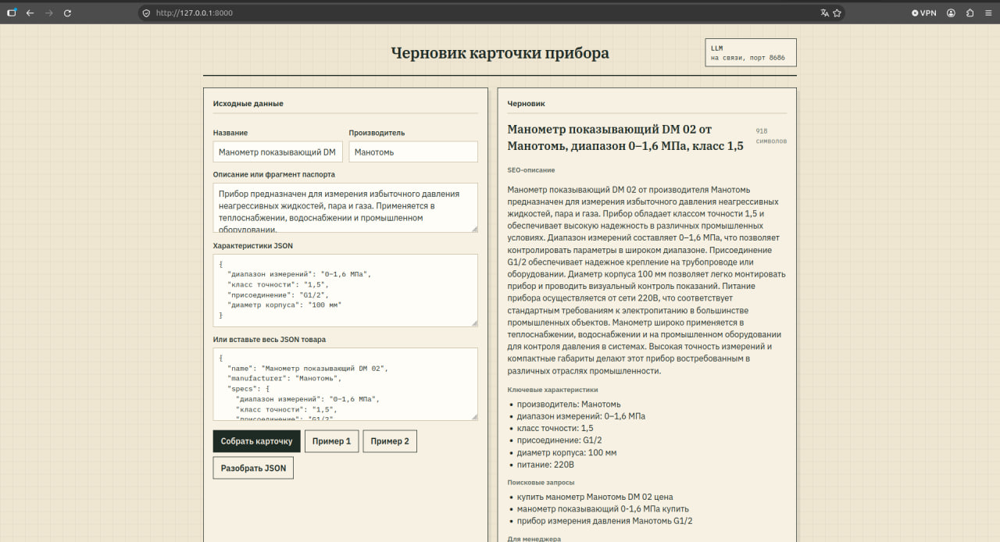

# Решение тестового задания 

В `source_test_task` — формулировка задания.

## Что реализовано

- `service_llm_local` — локальный OpenAI-совместимый сервер на llama.cpp (Qwen3.5-4B, CUDA, порт 8686).
- `service_llm_description` — сервис задания: FastAPI, LangGraph/LangChain, поиск паспорта в интернете если характеристик не хватает, JSON и веб-форма, Markdown для копирования.

## Запуск всего стека

Нужны Docker Compose и NVIDIA Container Toolkit. В контейнер LLM попадает хостовая GPU 0 (у меня просто 2 видео карты, если у вас больше, то нужно указать нужную GPU в файле compose.yaml или использовать все : `--gpus` опцию compose.).

```bash
docker compose up --build
```

Форма: http://127.0.0.1:8000  
API: http://127.0.0.1:8000/docs  
LLM: http://127.0.0.1:8686/health  

Веб-форма с готовой карточкой:

[](img/example.jpg)  

Первый старт LLM может занять несколько минут: образ уже собран, но веса грузятся в GPU. `description` ждёт `healthy` у `llm`.

Остановка:

```bash
docker compose down
```

## Запуск по отдельности

Только LLM:

```bash
cd service_llm_local
docker compose up -d
```

Только FastAPI, если LLM уже слушает `8686` на хосте:

```bash
cd service_llm_description
docker compose up --build
```

# Важно

Детали реализации сервисов приведены в `readme.md` (чтобы было удобно читать на `github`).
Особенно это касается `service_llm_description`, здесь по сути основной backend сервиса LLM.

```
Короткое сопроводительное сообщение: что реализовано, какие решения приняты, с какими
сложностями столкнулись.
```